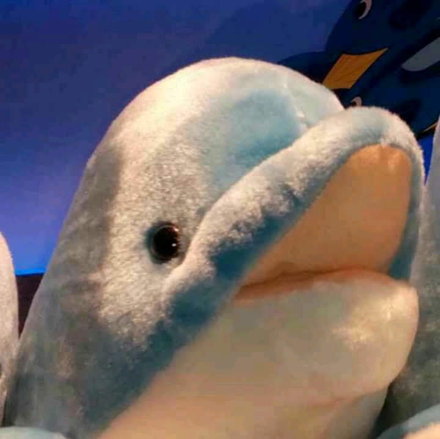

# Part 1: Origins from plushies

As with any good character, a good backstory makes it bloom even more.

I had a fond love for whales, for their freedom to roam the oceans freely and uninterrupted amongst the sanctuary of calm. They seem like innocent animals that hold a lot, and I aspire to emerge from the ocean like them.

Therefore, depictions whales have accompanied me through childhood. That brings me to the when.

## Illness & Ocean Park visit

I had a rather poor upbringing financially. We never really went anywhere other than the surrounding neighbourhood just to save up enough cash for meals, especially after a terrible accident my father had been involved in.

Therefore, it was a devastation for the family to have developed _necrotizing fasciitis_ after a chickenpox incident in **February 2015** (I was 7 years old back then!). Apart from caring for my two younger brothers, time and effort had to be spent on daily hospital visits.

Perhaps it was the realization that **spending time together is something a family does**, we went to more ambitious places around Hong Kong after the ordeal. Ocean Park is the big place we went to first that December, since some community organization was handing out free tickets.

At the time, the park had shows involving dolphin performances. Adding to the fact that it was ocean themed means I would encounter a plushie similar to a dolphin or whale. This is where the confusion arises, my whale is actually **a dolphin in disguise**!

I feel like my life has been filled with moments of desparation and hopelessness, but it is through these instances I gain buddies for acompany, and it should be that as well. In a sense, whether it is a dolphin or a whale does not matter. All that mattered was the fact that it has been here since childhood, and will continue to stay with me as an identity.

## Souvenir store encounter

Being taught to save up for the family, I never really requested for much back then. The experience of entering souvenir stores is still filled with wonder and hope – the wonder of seeing and touching something I won't have now, and the hope for owning that in the future.

<figure style="text-align: center;">

<figcaption>The dolphin plushie from Ocean Park. Cropped version stored on Google Photos since 2018-08-22, original lost to time.</figcaption>
</figure>

Looking at it again, I personally do think it is more a whale, and the opened mouth makes it more so. However, the body dimensions are less obvious. Dolphins should be more slender than whales, but it is not reflected that much from this image.

Nonetheless, I have kept this image around on some platforms, notably my mother's TaoBao and IdleFish account. It was simply left alone after I had explored the platform back in 2018, never to be touched again. If not for the preservation through obscurity, perhaps I would not have remembered the reasons behind my origins for whales and dolphins.

As with whether I have purchased the whale, the answer is a firm no. If anyone does own that exact plushie from Ocean Park, though, I would love to be friend with you.
